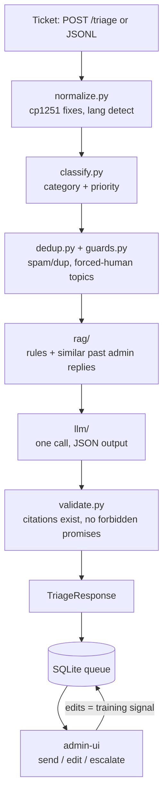

# Architecture

## Goal and scoring

| Criterion | Weight | Our lever |
|---|---|---|
| Draft quality (blind admin review vs real reply) | 30% | RAG over rules **and** past admin replies → drafts sound like real admins |
| Classification (category accuracy, priority macro-F1) | 25% | Local classifier trained on LLM-labeled + hand-checked data, rule overrides for p0 |
| No hallucinations (invented rule = ticket zeroed) | 20% | Deterministic citation validator — cannot cite a rule id that doesn't exist |
| Kazakh & Uzbek quality | 15% | cp1251 normalization, language-specific prompting, native-speaker check |
| Cost ≤ $0.002/ticket, p95 ≤ 5s | 10% | Exactly one LLM call per ticket; everything else local |

## Pipeline

## Modules

| Module | Responsibility | Owner |
|---|---|---|
| `normalize.py` | Map cp1251 look-alikes (ќ→қ, ґ→ғ, ѕ→ң, є→ә, ј→ө, ў→ұ, ї→ү), clean text, detect language (ru/kk/uz/en/und) | Backend |
| `classify.py` | Category per `taxonomy.json`, priority p0–p3. Local model + hard rules for p0 | Tech Lead |
| `dedup.py` | Same reporter + similar text within a time window → duplicate | Backend |
| `guards.py` | Payments, ban appeals, account hacking, refunds → `needs_human=true` always | Backend |
| `rag/` | Index `rules.json` by item id; index past tickets with admin replies; hybrid BM25 + embeddings | Tech Lead |
| `llm/` | Provider abstraction (Gemini / Groq / local), prompts, structured JSON output | Tech Lead |
| `validate.py` | Strip/replace any cited id not in `rules.json` or not retrieved; block promises of unban/refund/punishment | Tech Lead |
| `pipeline.py` | Orchestrates the steps, measures latency per step | Tech Lead |
| `api/` | HTTP endpoints, SQLite storage | Backend |
| `eval/` | Metrics, cost per ticket, p95 latency | Infra/QA |

## Key design decisions

1. **One LLM call per ticket.** Classification, language, dedup, guards are local → cheap and fast.
2. **Validator is code, not prompt.** The LLM may hallucinate; the validator guarantees it never reaches the output.
3. **Guards override the model.** Mandatory human topics are decided by rules before and after the LLM.
4. **Facts from players are claims, not truth.** Drafts never state a violation as proven; punishment is confirmed by an admin.
5. **Admin replies are the knowledge base.** 120k real answers give style and standard instructions beyond the rules.
6. **Mock data is labeled.** Anything not from the real pipeline is marked `stub`/`mock` and lives in separate folders.

## Stack

Python 3.12+ · FastAPI · pydantic · scikit-learn · SQLite · Next.js + TypeScript + Tailwind · Docker · LLM via provider abstraction (free tier first, paid only if agreed).
